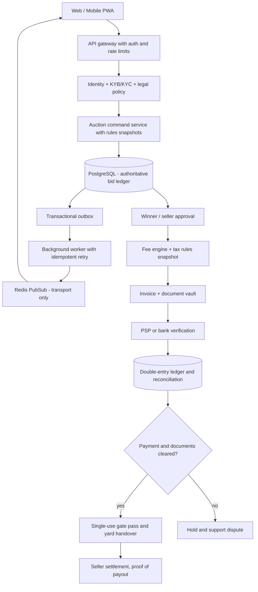

# ENCHEV AUCTIONS — 119-DAY ARCHITECTURE EXECUTION CONTRACT
**Version:** 2026-11-03.1 · **Deadline:** 01 March 2027 · **Status:** proposed, not delivered implementation

## 0. What is and is not meant by the comparison

- The system is based on the **public customer-facing workflow** of international automotive auction houses, including Copart Spain and Copart USA.
- Neither their proprietary source code nor their internal deployment topology, schema, algorithms, infrastructure configuration or confidential manuals are available. The architecture below is **our own proposed implementation**, not a reverse-engineered claim about the competitor's private systems.
- Publicly documented features include two-stage pre/live bidding, max bid/autobid, bid increments, optional Buy Now and seller approval in US markets, and separate payment / fee / vehicle-release operations in Spain. Their rules vary by country and must not be indiscriminately copied.
- Original `app/data/urgent-119-days.json` remains **119 days**, **799 old estimated team hours**, `2026-11-03` through `2027-03-01`. D001 acceptance and 4,374 Master System tasks are unchanged. Architecture may require re-estimation.

Official references:
- Public bidding mechanisms (US): https://www.copart.com/content/us/en/landing-page/ways-to-bid
- Official glossary of public modes: https://www.copart.com/content/us/en/landing-page/copart-glossary
- ES buyer fees, payment, gate pass and documents: https://www.copart.es/en/Content/es/en/Support/FAQ-Topics/Index
- ES fee table conflicting mirror: https://www.copart.es/en/Content/es/de/support/faq-topics/index
- 2025 Copart annual 10-K for agent/principal operating models: https://ebs.publicnow.com/view/DFD4F7A7BB9459AD0129D58236D158E49526742E

## 1. System architecture (proposed for ENCHEV)

**Trust boundaries**: client cannot create accepted bids/winner or mark invoices PAID; Redis cannot finalize auction; documents storage cannot independently approve ownership; no payout without legally approved and reconciled money source; a gate pass requires verified payment+title documents, and is single-use.

## 2. Data, interface and proof expectations

Every one of D001–D119 has a record in `app/data/urgent-auction-architecture-119-v1.json` with:

- Day ID, original title/date/owner/hours/acceptance, dependency IDs and architecture stage.
- Specific business outcome, component boundaries, data entities / tables, API or interface contract.
- Three implementation-step descriptions, intended positive and negative tests, required proof artifact.
- Linked CP feature IDs, fee codes, document types, legal requirement links and approval signatures.
- A literal `readiness:"architecture-specified-not-proven"` guard.

**Important distinction:** The named endpoints/table types are **targets**, not proof that the code or DB already contains them. The implementation must be verified using actual running APIs, migrations, CI and measured evidence.

## 3. 17 implementation stages

| Week / days | Domain | Signed exit requirement |
|---|---|---|
| 01 · D001–D007 | Environments, verification, staging and auth/Redis truth | Health and production boundaries proven; never fake GO |
| 02 · D008–D014 | Membership, identity, buyer/seller permissions, KYC | Signed membership/fees/eligibility policy and negative access tests |
| 03 · D015–D021 | Vehicle intake, title, media and seller documents | Ownership checked; lot publish conditional |
| 04 · D022–D028 | Catalog, lot details, yards and auction rules | DB catalog, signed auction rules and phone seller demo |
| 05 · D029–D035 | DB authoritative auction and first bid transaction | Atomic bid, state machine and server clock |
| 06 · D036–D042 | Concurrency, idempotency, proxy rules and live UI | No duplicate accepted bids and deterministic sequence |
| 07 · D043–D049 | Reserve, seller approval, winner, cancel/relist | One winner or unsold + immutable close trail |
| 08 · D050–D056 | Realtime, outbox, Redis delivery and resync | 60-minute staged auction with 3+ clients, no lost bids |
| 09 · D057–D063 | Versioned buyer/seller fees, documents and payment demo | No real money; complete sandbox transaction |
| 10 · D064–D070 | Evidence vault, fault injection, closed demo acceptance | Signed buyer/seller/admin E2E with zero P0 |
| 11 · D071–D077 | Lawyer/accountant, tax, AML applicability and PSP model | Real-money NO-GO without signed legal+finance |
| 12 · D078–D084 | PSP/bank reconciliation, invoice, refund, seller settlement | 10/10 zero-discrepancy sandbox financial scenarios |
| 13 · D085–D091 | Security, pentest, RLS, backup and load | 0 Critical/High, measurable RPO/RTO, safe recovery |
| 14 · D092–D098 | Single-car controlled real pilot | One real car only if full GO; otherwise dry run |
| 15 · D099–D105 | 2-lot pilot, mobile PWA, notifications and operations | Cross-auction isolation and documented delivery |
| 16 · D106–D112 | UX, legal isolation, monitoring, release readiness | Signed legal, finance, security, operations and load gates |
| 17 · D113–D119 | Freeze, E2E, rollback, client acceptance and launch | 01.03 beta only on signed GO; 24-hour watch and rollback |

## 4. Commercial and document architecture

The cross-reference layer remains `app/data/urgent-auction-benchmark-v1.json` and its 76 `CP-` controls, 20 fee components, 17 document workflows and 8 sign-offs. Financial architecture requires:
- `fee_rule_version` with effective range, country, tier, currency, tax category, payer, exclusions, snapshot hash and approved owner.
- Values stored in integer minor units (or appropriate audited decimal), with *explicit rounding*, reference currency, tax treatment and zero surprise fees.
- Customer preview of estimated all-in total **before the binding bid** and immutable issued invoice/credit note later.
- Separate buyer hammer price, buyer fees, seller fees, tax owed, held deposits, platform recognized revenue, payment costs, seller payable, refunds and transport service.
- PSP-signature-verified events or separately dual-approved bank statement references. Idempotent ledgers and settlements; deposit is liability, never revenue.
- Document graph `seller_agreement → vehicle_title → lot_snapshot → bid_award → terms_version → invoice → payment_proof → ownership_transfer → release_pin → signed_handover → seller_settlement`. Cross-border/ELV branches require separate review.
- Every document: issuer/legal entity, signers, country, version/hash, required/optional flag, verified status, access and retention policy, expiry, linked transaction.
- No production legal invoice, payment, title transfer or real release unless lawyer/accountant confirmed applicability.

## 5. Execution order and evidence

- Never skip predecessor `Dnnn`; do not mark children GREEN based on future intent.
- When implementing a day, open its card in the 119-day panel. Read *both* original PASS criterion and the detailed architecture's positive, negative and linked CP/fee/doc proof.
- A missing required legal or payment signature means BLOCKED/NO-GO for the money-backed stage, while unaffected demos may continue safely.
- P0 requirements affect launch; P1 can be deferred if the signed business owner confirms they are not required for the controlled pilot.
- The original 799h figure is **historical**. A new delivery estimate needs staffing and critical path review, especially for legal/PSP contract waiting, external pentest, cross-country tax and real pilot.

## 6. Acceptance definition for 01 March

A valid **real-money beta** must produce a signed trace for:

verified seller + legitimate vehicle + legally eligible buyer → accepted auction rules → authoritative bid → deterministic win or seller approval → fee/tax snapshot → correct invoice → reconciled bank/PSP payment → original title documents → one-use release → signed carrier/yard pickup → seller settlement / account reconciliation.

No signed GO: launch remains **restricted demo / sandbox**. Website availability is not authorization to trade.

## 7. Current implementation distinction

The architecture file, visual dashboard, cross-links and CI contracts are **planning/tooling**. Creation of this document does not create database entities, provider credentials, contractual commitments or genuine vehicle sales.

Tests: `node scripts/verify-urgent-auction-architecture.mjs`, `node scripts/verify-urgent-copart-parity.mjs`, the existing CI suite, build, cross-device UI review, and OWASP ZAP.
